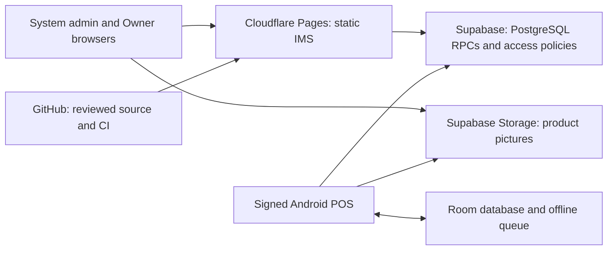

# First-release deployment plan

Updated: 2 November 2026. Status: proposed plan. This revision updates hosting choices and source findings; it does not deploy the project or mark release tasks complete. Record execution evidence in [FIRST_RELEASE_TASKS.md](FIRST_RELEASE_TASKS.md).

Execution update, 5 November 2026: local preflight is recorded in [DEPLOYMENT_PREFLIGHT_2026-11-05.md](DEPLOYMENT_PREFLIGHT_2026-11-05.md). The current source already includes `build:production` and production-mode CI checks. The findings dated 2 November below are historical. The candidate remains an uncommitted working tree; do not deploy the older `develop` or `main` revisions.

The newer security implementation also requires the `admin-passkey` and `pos-gateway` Supabase Edge Functions. Before hosted acceptance, reserve a stable development HTTPS hostname, inspect the actual pending security migrations, and follow the rollout and enrollment procedures in [supabase/README.md](../supabase/README.md). Set `ADMIN_WEBAUTHN_ORIGIN` to that exact hostname's origin, deploy both functions to the verified development project, and verify custom-session authorization and POS device proof before testing management or synchronization. Service credentials stay in server configuration. Database migrations alone do not deploy these functions. Existing queued POS sales need the documented reconciliation and compatible client rollout before the catalog/device policy changes.

These are prerequisites for initial client testing: the web requires passkey verification for each fresh System Administrator session even before the global SQL policy is enabled, and Android immediately sends login and normal API calls through `pos-gateway`. Prepare private admin enrollment codes before the first admin sign-in and deploy the gateway before updating the handset. Enroll existing device keys before enabling global proof enforcement; confirm automatic handset date/time because signed requests allow only 90 seconds of clock difference.

## Recommended platforms and cost

Use **Cloudflare Pages Free** for the React IMS and Owner dashboard, retain **Supabase** for PostgreSQL, RPCs, access policies and product pictures, and retain **GitHub Actions** for checks. Install the Android POS as a signed APK on the stall's managed phone. This fits the existing architecture without an additional application server.

| Component | Platform | Relevant free allowance | Decision |
| --- | --- | --- | --- |
| IMS and Owner website | Cloudflare Pages Free | 500 builds/month, one concurrent build, 20,000 files/site, 25 MiB maximum per asset | Separate development/UAT and eventual production sites. [Limits](https://developers.cloudflare.com/pages/platform/limits/) |
| Website delivery | Cloudflare Pages | Static requests are free and unlimited; Functions have separate Workers quotas | Serve the Vite output as static files. Backend requests continue to Supabase. [Pricing](https://developers.cloudflare.com/pages/functions/pricing/) |
| Database and pictures | Supabase Free | 500 MB database/project, 1 GB file storage, 5 GB egress plus 5 GB cached egress; two active free projects | Reuse separate development and production projects. Free projects can pause after a week of inactivity and have no automatic backups. [Pricing](https://supabase.com/pricing) |
| Automated checks | GitHub Actions | Standard hosted runners are free for public repositories; private repositories consume included usage | Reuse the existing Linux workflow; verify visibility, billing limits and artifact retention. [Billing](https://docs.github.com/en/billing/concepts/product-billing/github-actions) |
| Android installation | Signed APK installed directly | No hosted runtime needed | Build locally initially and retain controlled release copies. |
| Website address | Default HTTPS `*.pages.dev` | Avoids a domain purchase for the pilot | Proposed names: `coolerz-ims-dev` and `coolerz-ims`, subject to availability. |

**Target infrastructure cost: $0/month within these allowances**, using existing hardware and suitable existing private backup storage. Current subscriptions and consumption have not been verified. A custom domain, extra storage, paid CI usage or a paid backend changes that budget. Suitability for one stall is an initial estimate: measure database growth, picture downloads and synchronization traffic during UAT.

Cloudflare is preferable here to Netlify Free's shared **300-credit monthly allowance** ([Netlify pricing](https://www.netlify.com/pricing/)). Vercel Hobby permits personal, noncommercial use, so it is unsuitable for the business deployment ([Vercel Hobby](https://vercel.com/docs/plans/hobby)). Replacing Supabase would require adapting the existing SQL/RPC and storage contracts.

## Architecture and access



The System administrator and Owner use the same web address; roles select the available screens. Owners can add it to the iPhone home screen. The dashboard needs internet for live data. Android retains queued work locally and synchronizes when connected; it is installed on the phone rather than hosted on Pages.

The application uses custom password RPCs and `X-Session-Token`, rather than Supabase Auth providers; see [supabase/README.md](../supabase/README.md). Test the existing session, role and device controls. SMTP and OAuth configuration are outside the current deployment requirements.

## Current repository findings

These are local observations from 2 November, not a production readiness certification:

- Current branch: `codex/restore-latest-development`, based on `e72814e`, with uncommitted work. Local `develop` and `main` exist. Preserve and review the work before selecting a release commit; do not publish an old branch simply because its name matches the intended environment.
- [ENVIRONMENTS.md](ENVIRONMENTS.md) specifies development-only local operation. Production credentials are disconnected. Development reference: `fhyqrgxwdqlyzxsnpthr`. Retained production reference: `hdtizzdrbscchvqwcpkb`; confirm its identity and data independently before production work.
- **Both `pnpm build` and `pnpm --dir apps/web-ims build` currently build in development mode.** The previous plan's production-build instruction is obsolete. Use the explicit command below for an eventual production release.
- `.github/workflows/pr-checks.yml` already checks web lint/tests/development build, Android tests/lint/build and disposable database migrations. CI pins Node `24.19.0`, pnpm `11.21.0`, JDK 17 and Android SDK/build tools 36. No new CI run was performed for this planning revision.
- Android has `dev` and `production` flavors, but only debug signing is configured. Production release signing remains a blocker. Current `versionCode` is `1`.
- The linked project reference is the intended development project. A fresh `supabase migration list --linked` attempt with telemetry disabled failed with `AccessTokenRequiredError`. **Current remote migration state is unverified.** The 24 October evidence described `202610140001_product_images.sql` and `202610240001_integrate_product_images.sql` as pending; that is historical evidence, not today's pending list.
- [24 October integration evidence](2026-10-24_INTEGRATION.md) and the [phone checklist](R09_PHONE_TEST_CHECKLIST.md) still require combined-build handset/UAT evidence. A scheduled deployment date does not prove deployment occurred. Live hosting, subscription plans and devices were not inspected in this planning pass.

## Environment layout and build settings

Start with hosted development for phone testing. Production is a later stage after acceptance, signing and recovery preparation.

| Environment | Web project / reviewed branch | Backend | Data |
| --- | --- | --- | --- |
| Local development | Local Vite server | Development Supabase | Test only |
| Online development/UAT | `coolerz-ims-dev` / `develop` | `fhyqrgxwdqlyzxsnpthr` | Test only |
| Eventual live operation | `coolerz-ims` / accepted `main` | Independently confirmed production project | Real accounts, stock and sales |

Reuse the two existing backend environments. The two-active-project free limit spans organizations where the account is an Owner or Administrator ([Supabase billing](https://supabase.com/docs/guides/platform/billing-on-supabase)). Use disposable local Supabase for destructive fixtures and restore rehearsals.

For both Git-integrated Pages projects, use the **repository root** as the build root and **`apps/web-ims/dist`** as the output directory. Set `NODE_VERSION=24.19.0` and `PNPM_VERSION=11.21.0` to match CI; confirm these versions and a frozen lockfile installation in the build log. See [build configuration](https://developers.cloudflare.com/pages/configuration/build-configuration/) and [build image settings](https://developers.cloudflare.com/pages/configuration/build-image/).

| Setting | Development/UAT | Production, after acceptance |
| --- | --- | --- |
| Build command | `pnpm install --frozen-lockfile && pnpm --dir apps/web-ims build:development` | `pnpm install --frozen-lockfile && pnpm --dir apps/web-ims build:production` |
| `VITE_APP_ENV` | `development` | `production` |
| `VITE_SUPABASE_URL` | Development URL | Confirmed production URL |
| `VITE_SUPABASE_ANON_KEY` | Development public client key | Production public client key |
| `VITE_SUPABASE_PRODUCTION_URL` | Production URL for the isolation guard only | Not required |
| Primary deployment branch | Reviewed `develop` | Accepted `main` |
| Preview branches | Disabled initially | Disabled |

PR checks compile the production IMS and POS variants with isolated placeholder endpoints. Before publishing the IMS, match the Cloudflare deployment commit to the revision accepted by CI.

Pages calls its primary branch the "production branch" even in the development project. For `coolerz-ims-dev`, put development backend values in that project's primary deployment environment. For `coolerz-ims`, keep automatic primary-branch deployment disabled until the first approved release and disable previews. Verify current branch protections in GitHub before enabling releases. [Pages branch controls](https://developers.cloudflare.com/pages/configuration/branch-build-controls/)

Vite embeds `VITE_*` values into public files. Use a public client key compatible with the existing custom-session flow. Keep service-role/secret keys, database passwords, CLI tokens and signing passwords out of client configuration. Deployment variables must override local development configuration. Rebuild after changes. Verify the rendered environment label, browser network destination and absence of the development endpoint from production assets.

## Execution sequence

| Stage | Work | Completion check |
| --- | --- | --- |
| 1. Select the candidate | Preserve local work, review recovered source, identify one commit, confirm branch rules and run CI including the production build checks. | Reviewed candidate passes all required checks. |
| 2. Prepare development backend | Authenticate CLI, verify link/history, inspect pending SQL and preview it, then apply reviewed migrations to development. Check picture storage policies and web/POS RPCs. | Remote history and backend behavior match the candidate; no live fixture ran. |
| 3. Publish development IMS | Configure `coolerz-ims-dev` with the settings above. | HTTPS works on desktop/iPhone, shows DEVELOPMENT DATABASE, reaches only development and supports Owner/admin login. |
| 4. Complete acceptance | Use the development APK and hosted IMS: activation, pictures, recipes, receiving, open/sell/deduct/close, offline queue, retry, restart, fingerprint, recovery and in-place update. Check role/cross-stall denial and reconcile figures. | Each sale appears once, acknowledged queues reach zero, stock/cash/profit agree and staff sign off. |
| 5. Prepare production | Inventory retained data, migration history, installed package/certificate and pending queue. Configure/back up release signing, increment version code and prove backup restore. | Starting state, signed APK, compatible rollout and recovery procedure are recorded. |
| 6. Release in a quiet window | Sync/reconcile the existing phone, take a backup, apply reviewed compatible production migrations, publish accepted web build, then install/activate matching signed APK. | Production identity, role limits and a controlled first real sale pass; IMS/POS agree. |
| 7. Supervise the pilot | Operate one stall for three consecutive fully reconciled days, with paper fallback ready. | Daily sales, deductions, cash, stock and Owner figures reconcile and staff accept the release. |

Stages 1-4 are the immediate path. Use [DEVELOPMENT_UAT.md](DEVELOPMENT_UAT.md) for expected figures and [FIRST_RELEASE_TASKS.md](FIRST_RELEASE_TASKS.md) for owners/evidence. Old test results do not cover a changed candidate. Server changes must remain compatible with installed clients during rollout.

## Migration commands: repository-root PowerShell

These are execution instructions, not operations performed by this plan. Authenticate interactively and keep credentials out of Git and chat. Begin with development:

```powershell
Set-Location 'C:\Desktop Apps and Files\Ice cream system'
$env:SUPABASE_TELEMETRY_DISABLED = '1'
.\node_modules\.bin\supabase.cmd login
.\node_modules\.bin\supabase.cmd link --project-ref fhyqrgxwdqlyzxsnpthr
if ((Get-Content -LiteralPath 'supabase/.temp/project-ref' -Raw).Trim() -ne 'fhyqrgxwdqlyzxsnpthr') { throw 'Unexpected linked project' }
.\node_modules\.bin\supabase.cmd migration list --linked
Get-ChildItem -LiteralPath 'supabase/migrations' -File | Sort-Object Name | Select-Object Name
.\node_modules\.bin\supabase.cmd db push --dry-run
```

Inspect the actual pending files and SQL against the intended candidate. Investigate differences before continuing. Only after review, apply and verify:

```powershell
if ((Get-Content -LiteralPath 'supabase/.temp/project-ref' -Raw).Trim() -ne 'fhyqrgxwdqlyzxsnpthr') { throw 'Unexpected linked project' }
.\node_modules\.bin\supabase.cmd db push
.\node_modules\.bin\supabase.cmd migration list --linked
```

For the eventual production window, first confirm the retained reference below in the dashboard and finish the inventory, backup and compatibility review. Run separately from the development block:

```powershell
$productionProjectRef = 'hdtizzdrbscchvqwcpkb'
.\node_modules\.bin\supabase.cmd link --project-ref $productionProjectRef
if ((Get-Content -LiteralPath 'supabase/.temp/project-ref' -Raw).Trim() -ne $productionProjectRef) { throw 'Unexpected linked project' }
.\node_modules\.bin\supabase.cmd migration list --linked
.\node_modules\.bin\supabase.cmd db push --dry-run
```

After reviewing that production pending list and SQL, apply in the planned window, verify and restore the development link:

```powershell
if ((Get-Content -LiteralPath 'supabase/.temp/project-ref' -Raw).Trim() -ne $productionProjectRef) { throw 'Unexpected linked project' }
.\node_modules\.bin\supabase.cmd db push
.\node_modules\.bin\supabase.cmd migration list --linked
.\node_modules\.bin\supabase.cmd link --project-ref fhyqrgxwdqlyzxsnpthr
Get-Content -LiteralPath 'supabase/.temp/project-ref'
```

Stop on any failed command. A dry run does not apply migrations. SQL Editor changes do not appear in CLI history; reconcile discrepancies rather than blindly replaying SQL or repairing history. Never use `db reset --linked` or run fixtures against a live project. Any new migration must have a unique version prefix; this plan creates none.

## Android release

Configure a production signing key outside Git and back it up securely. Confirm the installed app's identity before replacing it; Android updates need the existing signing identity ([Android signing](https://developer.android.com/studio/publish/app-signing)). Restore production URL/public client key only when preparing the approved release. Keep the `.dev` package separate.

After production configuration and release signing exist, build from repository-root PowerShell:

```powershell
Push-Location 'apps/android-pos'
if (!(Test-Path 'gradle/verification-metadata.xml' -PathType Leaf)) { throw 'Gradle verification metadata is missing.' }
.\gradlew.bat :app:assembleProductionRelease --dependency-verification=strict
Pop-Location
```

Currently this variant is unsigned: the command alone does not produce an installable release. Verify the signed APK, certificate, application ID, incremented `versionCode` and SHA-256 before private distribution. Record them with the source commit and web deployment ID. Rehearse an in-place update with queued development data on a physical phone. Never uninstall a POS with unsynced records; cloud backups cannot recover its phone-only queue. Keep APK distribution separate from the Pages site.

## Backups, recovery and free-plan operation

- **Backup:** export after each reconciled close and before migrations, encrypt and copy outside the development computer to controlled private storage. Test coverage of application public/private schema objects, data, grants and required configuration. Keep seven daily and four weekly copies initially. Dumps can contain staff password hashes and session tokens. Supabase recommends off-site CLI exports for Free; database backups exclude Storage object bytes, so copy product pictures separately. [Backup documentation](https://supabase.com/docs/guides/platform/backups)
- **Recovery:** rehearse in disposable local Supabase and verify logins, roles, pictures, ledger totals and RPCs. Proposed targets for Owner acceptance: at most one reconciled day's cloud data loss with daily exports, and recovery within four hours. These are targets to prove. Increase export frequency or choose paid recovery support if that loss is unacceptable.
- **Operation:** check POS pending/rejected work, reconciliation and backup completion each operating day. Review Supabase usage and pause notices weekly. Verify backend availability before reopening after a long closure. Avoid unnecessary keep-alive traffic.
- **Capacity:** investigate at 70% of database/storage/transfer allowances and plan action by 85%; these are proposed operational thresholds. Compress pictures before upload: the current app allows 5 MB files without automatic optimization. A suggested target is 100-300 KB per image. Preserve measured headroom for indexes, existing data and sync bursts.
- **Rollback:** retain the previous compatible web deployment and signed APK. Pages supports reverting a successful primary deployment ([rollbacks](https://developers.cloudflare.com/pages/configuration/rollbacks/)). A web rollback does not reverse SQL. Use a reviewed database forward fix or tested restore; avoid Android downgrades after Room schema changes. Preserve the phone and use numbered paper receipts if reconciliation or sync fails.

When uninterrupted backend availability or managed daily backups becomes necessary, budget for Supabase Pro **from US$25/month**; additional projects in a paid organization start at **US$10/month** ([pricing](https://supabase.com/pricing)). Plans apply to whole organizations: keep development in a separate Free organization if eligible when upgrading production, or budget for both paid projects ([organization billing](https://supabase.com/docs/guides/platform/billing-on-supabase)). Pages can remain Free. Pictures and phone-only records still need their own recovery procedures.

The first implementation work is to identify the candidate, authenticate and verify development migration history, add explicit production build coverage and configure the development Pages project. Production follows completed acceptance and recovery checks.
